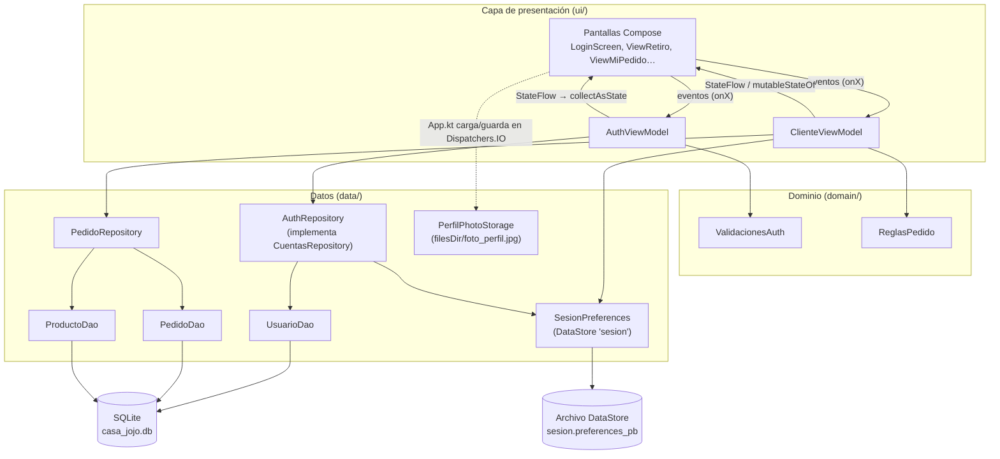
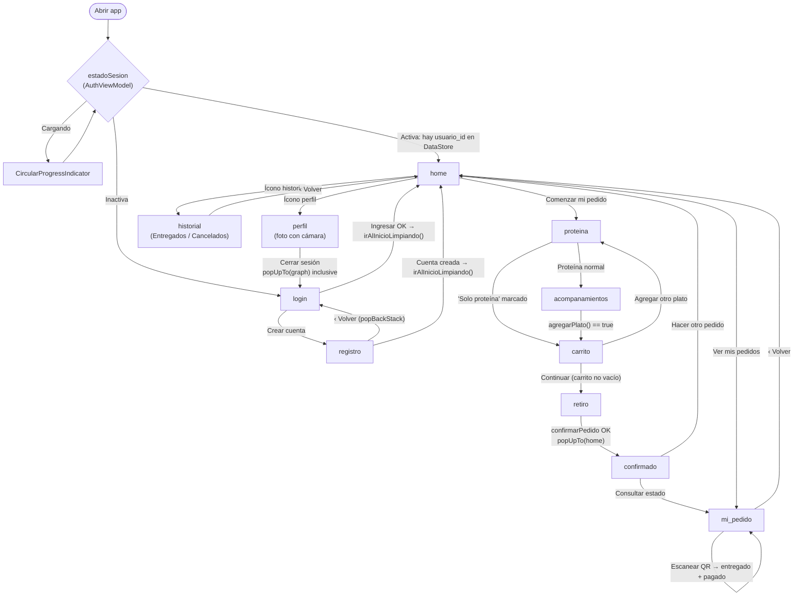
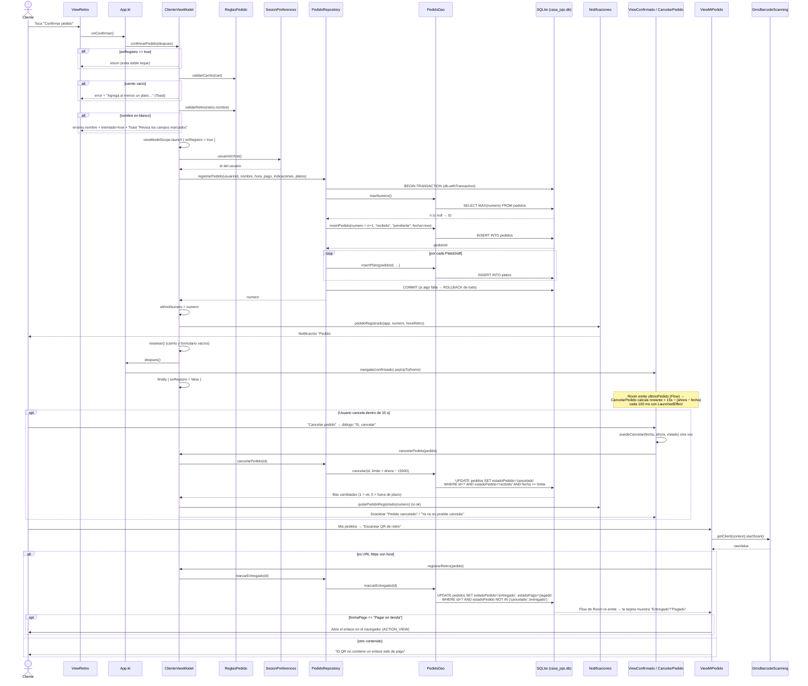
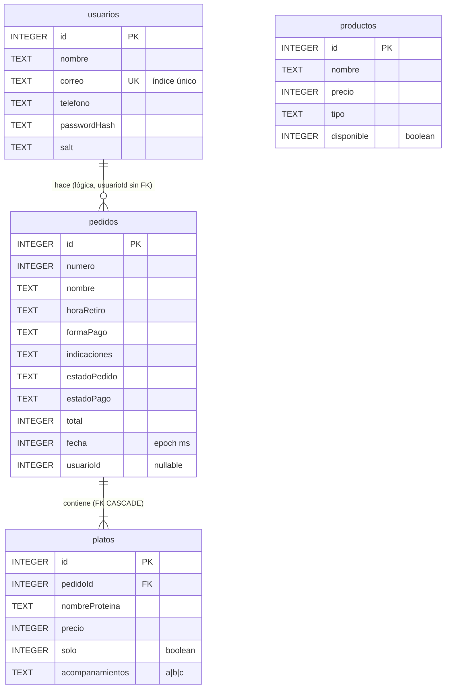

# Guía de defensa — App Android "La Casa JoJo" (DSY1105)

> Guía de estudio basada en el código real de `casajojo-android` (rama `android`).
> Todas las rutas de archivo son relativas a `app/src/main/java/cl/duoc/casajojo/` salvo que se indique otra cosa.
> Formato de cita: `carpeta/Archivo.kt → función()`.

---

## 1. Resumen del proyecto

1. **La Casa JoJo SpA** es un local de almuerzos que vende menús armados: una **proteína** + **acompañamientos**, para **retirar** en el local.
2. El problema: los pedidos se tomaban de forma manual; la app permite que el cliente arme y registre su pedido solo, con número y hora de retiro.
3. **Quién la usa:** el **cliente** del local (el panel de administración es otra app, `casajojo-web`, en la rama `web`).
4. El cliente **crea una cuenta** (nombre, correo, celular, contraseña) e **inicia sesión**; la sesión queda guardada.
5. **Arma el pedido:** elige proteína → acompañamientos (o "solo proteína" a $3.000) → revisa el **carrito** → indica **nombre, hora de retiro, forma de pago e indicaciones**.
6. Al confirmar, el pedido se guarda en **SQLite (Room)** con un **número correlativo** y llega una **notificación local**.
7. Durante **15 segundos** puede **cancelar** el pedido (RF-13).
8. En "Mis pedidos" ve el estado y puede **escanear el QR de la tienda** al retirar → el pedido queda **entregado y pagado** (RF-14); el **Historial** filtra entregados/cancelados.
9. Además usa **cámara** (foto de perfil), **compartir** (resumen del pedido) y **escáner QR** (Google Play Services).
10. Es la **"Opción A — local"**: no hay backend ni sincronización con el panel web; todo vive en el teléfono (Room + DataStore + archivo de foto).

---

## 2. Arquitectura

### 2.1 MVVM en esta app

| Capa MVVM | Qué es en esta app | Ejemplo real |
|---|---|---|
| **View** (vista) | Funciones `@Composable` que **solo dibujan** el estado y **avisan** eventos mediante lambdas. No validan ni guardan. | `ui/screens/auth/LoginScreen.kt → LoginScreen()` llama a `vm.onLoginCorreo` y `vm.iniciarSesion(...)` |
| **ViewModel** | Mantiene el estado de la pantalla, sobrevive a la rotación, lanza corrutinas (`viewModelScope`) y llama a reglas de dominio y repositorios. | `ui/viewmodels/AuthViewModel.kt`, `ui/viewmodels/ClienteViewModel.kt` |
| **Model** | Repositorios + Room + DataStore + reglas de dominio puras. | `data/repository/PedidoRepository.kt`, `domain/usecase/ReglasPedido.kt` |

Reglas clave que puedes decir en la defensa:

- **Las pantallas nunca navegan solas**: reciben `onVolver`, `onContinuar`, etc. y **`ui/App.kt → NavegacionApp()`** decide el destino.
- **El ViewModel no conoce SQL ni DAOs**: habla con el Repository (`data/repository/PedidoRepository.kt`, comentario "El ViewModel no conoce los DAO ni SQL").
- **No hay framework de DI** (ni Hilt ni Koin): los objetos se crean a mano. `AuthViewModel` recibe su repositorio por constructor mediante `AuthViewModel.Factory`; `ClienteViewModel` (un `AndroidViewModel`) crea su propia base, repositorio y `SesionPreferences`.
- **AuthViewModel depende de una interfaz** (`CuentasRepository`), por eso se puede testear con un repositorio falso en memoria (`app/src/test/.../AuthViewModelTest.kt`).

### 2.2 Estructura de carpetas

```text
cl.duoc.casajojo/
├── CasaJojoApplication.kt   Crea el canal de notificaciones al iniciar el proceso
├── MainActivity.kt          enableEdgeToEdge() + setContent { CasaJojoApp() }
├── data/                    TODO lo que toca almacenamiento
│   ├── local/
│   │   ├── CasaJojoDatabase.kt   Base Room (v2), migración 1→2, siembra del menú
│   │   ├── Converters.kt         List<String> ⇄ "a|b|c"
│   │   ├── MenuSeed.kt           14 productos iniciales
│   │   ├── SesionPreferences.kt  DataStore "sesion"
│   │   ├── PerfilPhotoStorage.kt Foto de perfil (archivos)
│   │   ├── dao/                  PedidoDao, ProductoDao, UsuarioDao (SQL)
│   │   └── entity/               Pedido(+PedidoWithPlatos), Plato, Producto, Usuario
│   └── repository/          AuthRepository (+CuentasRepository, ResultadoAuth), PedidoRepository
├── domain/                  Kotlin puro, SIN Android → testeable en JVM
│   ├── model/PlatoDraft.kt       Plato en memoria antes de guardarse
│   └── usecase/                  ReglasPedido, ValidacionesAuth (+RetiroErrores, RegistroErrores, LoginErrores)
├── navigation/AppRoutes.kt  sealed class con las 11 rutas
├── ui/
│   ├── App.kt               CasaJojoApp() + NavHost (mapa de navegación)
│   ├── components/          CampoTexto, Boton, OptionCard, ChipRow, CancelarPedido, ErrorEcho…
│   ├── layouts/             Pantalla (scroll + barra fija), BarraSuperior
│   ├── screens/auth/        LoginScreen, RegistroScreen
│   ├── screens/cliente/     ViewHome, ViewProteina, ViewAcompanamientos, ViewCarrito, ViewRetiro,
│   │                        ViewConfirmado, ViewMiPedido, ViewHistorial, ViewPerfil
│   ├── theme/Theme.kt       Colores claro/oscuro (Material 3)
│   └── viewmodels/          AuthViewModel, ClienteViewModel y las "fichas" de estado (UiState)
└── utils/                   Contrasenas (PBKDF2), Notificaciones, Compartir, Formato (dinero, fechas, estados)
```

**Por qué esta separación:**

- `data/` aísla **cómo** se guarda (Room/DataStore/archivos). Si mañana hubiera API REST, solo cambia esta capa.
- `domain/` contiene las **reglas de negocio** (precios, validaciones, plazo de cancelación). Al no importar nada de Android se prueba con JUnit sin emulador.
- `ui/` solo presenta; `navigation/` centraliza los nombres de rutas (un error de tipeo no compila); `utils/` reúne ayudas transversales y recursos nativos.

### 2.3 Diagrama de capas



---

## 3. Navegación y rutas

Las rutas están en `navigation/AppRoutes.kt` (sealed class) y el grafo en `ui/App.kt → NavegacionApp()`.

| Ruta (`AppRoutes`) | `route` | Pantalla (composable) | Desde dónde se llega |
|---|---|---|---|
| `Login` | `login` | `ui/screens/auth/LoginScreen.kt → LoginScreen()` | Inicio sin sesión; "Cerrar sesión" en Perfil |
| `Registro` | `registro` | `ui/screens/auth/RegistroScreen.kt → RegistroScreen()` | Link "Crear cuenta" en Login |
| `Home` | `home` | `ui/screens/cliente/Home.kt → ViewHome()` | Inicio con sesión; tras login/registro; "Hacer otro pedido"; "Volver" de Carrito/MiPedido |
| `Proteina` | `proteina` | `ui/screens/cliente/Proteina.kt → ViewProteina()` | "Comenzar mi pedido" (Home); "Agregar otro plato" (Carrito) |
| `Acompanamientos` | `acompanamientos` | `ui/screens/cliente/Acompanamientos.kt → ViewAcompanamientos()` | Tocar una proteína disponible sin "solo proteína" |
| `Carrito` | `carrito` | `ui/screens/cliente/Carrito.kt → ViewCarrito()` | "Agregar al pedido" (si `agregarPlato()` = true); proteína con "solo"; botón "Ver mi pedido" en Proteína; chip del carrito en `BarraSuperior` (MiPedido, Historial) |
| `Retiro` | `retiro` | `ui/screens/cliente/Retiro.kt → ViewRetiro()` | "Continuar" en Carrito (solo con platos) |
| `Confirmado` | `confirmado` | `ui/screens/cliente/Confirmado.kt → ViewConfirmado()` | `confirmarPedido` exitoso en Retiro |
| `MiPedido` | `mi_pedido` | `ui/screens/cliente/MiPedido.kt → ViewMiPedido()` | "Consultar estado de mi pedido" (Confirmado); "Ver mis pedidos" (Home, solo si hay pedidos) |
| `Perfil` | `perfil` | `ui/screens/cliente/Perfil.kt → ViewPerfil()` | Ícono de cuenta en Home |
| `Historial` | `historial` | `ui/screens/cliente/Historial.kt → ViewHistorial()` | Ícono de historial en Home |

### 3.1 Flujo completo



### 3.2 Cómo se decide la pantalla inicial

En `ui/App.kt → CasaJojoApp()`:

1. `authVm.estadoSesion` es un `StateFlow<EstadoSesion>` con valor inicial `Cargando` (`ui/viewmodels/AuthViewModel.kt`, `stateIn(..., SharingStarted.Eagerly, EstadoSesion.Cargando)`).
2. Mientras es `Cargando` (DataStore aún no responde) se muestra un `CircularProgressIndicator` → así **no "parpadea" el login** a alguien con sesión.
3. Cuando llega `Activa(usuario)` o `Inactiva`, se calcula **una sola vez** con `remember { ... }`: `Home` si hay sesión, `Login` si no. Ese valor es el `startDestination` del `NavHost`.
4. El origen del dato es `AuthRepository.usuarioActual`: `sesion.usuarioId.flatMapLatest { id -> if (id == null) flowOf(null) else usuarios.porId(id) }`.

### 3.3 Cómo se limpia la pila

- **Al iniciar sesión o registrarse** → `ui/App.kt → irAlInicioLimpiando()`:
  `nav.navigate(home) { popUpTo(nav.graph.id) { inclusive = true }; launchSingleTop = true }`. Se borra todo (login/registro), así el botón atrás **no vuelve al login**.
- **Al cerrar sesión** (Perfil) → `authVm.cerrarSesion { vm.limpiarTodo(); nav.navigate(login) { popUpTo(nav.graph.id) { inclusive = true } } }`. Borra la sesión en DataStore, descarta el carrito del usuario anterior y deja solo Login en la pila.
- **Al confirmar un pedido** → `navigate(confirmado) { popUpTo(home) { inclusive = false } }`: se eliminan proteína/acompañamientos/carrito/retiro de la pila, así "atrás" no vuelve a un formulario ya enviado.
- **Volver al inicio** desde Carrito/MiPedido/Confirmado → `nav.popBackStack(AppRoutes.Home.route, false)`.

---

## 4. Flujo de un pedido paso a paso



Puntos para explicar oralmente:

- **Transacción** (`data/repository/PedidoRepository.kt → registrarPedido()`): `db.withTransaction { ... }` hace que pedido + platos se guarden "todo o nada", y que el `MAX(numero)+1` no se repita porque se lee y se inserta dentro de la misma transacción.
- **Número correlativo**: es **por dispositivo** (global de la tabla, no por usuario).
- **Notificación**: se usa `datos.horaRetiro` (copia tomada antes de `resetear()`), si no la notificación quedaría sin hora (`ClienteViewModel.kt → confirmarPedido()`).
- **15 segundos**: el plazo se calcula con `Pedido.fecha` guardada en Room, no con un temporizador en memoria → sobrevive a rotar o salir de la pantalla. Y se valida **tres veces**: en la UI (`CancelarPedido`), al confirmar el diálogo y en el `WHERE` del `UPDATE` (fuente de verdad).
- **Errores**: si Room falla, `catch (e: Exception)` muestra "No pudimos registrar tu pedido…" y **no borra el carrito**; `CancellationException` se relanza; `finally` libera el botón.

---

## 5. Persistencia de datos

### 5.1 Room / SQLite — tablas

Base: `casa_jojo.db`, **versión 2**, `exportSchema = false` (`data/local/CasaJojoDatabase.kt`). Room traduce: `Long`/`Int`/`Boolean` → `INTEGER`, `String` → `TEXT`, `List<String>` → `TEXT` (vía `Converters`). Tipos no nulos → `NOT NULL`.

**`usuarios`** (`data/local/entity/Usuario.kt`)

| Columna | Tipo SQLite | Restricción |
|---|---|---|
| `id` | INTEGER | PK AUTOINCREMENT NOT NULL |
| `nombre` | TEXT | NOT NULL (guardado con `trim()`) |
| `correo` | TEXT | NOT NULL, **índice único** `index_usuarios_correo` (guardado en minúsculas y sin espacios) |
| `telefono` | TEXT | NOT NULL (normalizado a 9 dígitos) |
| `passwordHash` | TEXT | NOT NULL (PBKDF2 en Base64) |
| `salt` | TEXT | NOT NULL (16 bytes aleatorios en Base64) |

**`pedidos`** (`data/local/entity/Pedido.kt`)

| Columna | Tipo | Restricción / significado |
|---|---|---|
| `id` | INTEGER | PK AUTOINCREMENT |
| `numero` | INTEGER | NOT NULL — correlativo `MAX(numero)+1` |
| `nombre` | TEXT | NOT NULL — nombre para el retiro |
| `horaRetiro` | TEXT | NOT NULL — "12:00" … "15:00" |
| `formaPago` | TEXT | NOT NULL — "Transferencia" / "Pagar en tienda" |
| `indicaciones` | TEXT | NOT NULL (puede ser "") |
| `estadoPedido` | TEXT | NOT NULL — `recibido`, `cancelado`, `entregado` (la UI también conoce `preparacion` y `listo`) |
| `estadoPago` | TEXT | NOT NULL — `pendiente`, `pagado` (la UI también conoce `no_pagado`) |
| `total` | INTEGER | NOT NULL — suma de precios de los platos |
| `fecha` | INTEGER | NOT NULL — epoch en milisegundos |
| `usuarioId` | INTEGER | **NULLABLE**, sin FK ni índice — dueño del pedido (agregado en v2) |

**`platos`** (`data/local/entity/Plato.kt`)

| Columna | Tipo | Restricción |
|---|---|---|
| `id` | INTEGER | PK AUTOINCREMENT |
| `pedidoId` | INTEGER | NOT NULL, **FK → pedidos.id ON DELETE CASCADE**, índice `index_platos_pedidoId` |
| `nombreProteina` | TEXT | NOT NULL (copia del nombre, no FK a productos) |
| `precio` | INTEGER | NOT NULL |
| `solo` | INTEGER (boolean) | NOT NULL — 1 = solo proteína |
| `acompanamientos` | TEXT | NOT NULL — lista unida por `|`, p. ej. `Arroz|Ensalada` |

**`productos`** (`data/local/entity/Producto.kt`)

| Columna | Tipo | Restricción |
|---|---|---|
| `id` | INTEGER | PK (**no** autogenerada; ids 1–14 fijos de `MenuSeed`) |
| `nombre` | TEXT | NOT NULL |
| `precio` | INTEGER | NOT NULL (proteínas 4.600/4.800, acompañamientos 0) |
| `tipo` | TEXT | NOT NULL — `proteina` / `acompanamiento` |
| `disponible` | INTEGER (boolean) | NOT NULL — "Cerdo mongoliano" viene en `false` (agotado) |

Relaciones:

- `pedidos 1 — N platos` real (FK con cascada). Room la lee con `PedidoWithPlatos` (`@Embedded` + `@Relation(parentColumn="id", entityColumn="pedidoId")`).
- `usuarios 1 — N pedidos` **lógica** (columna `usuarioId`), **sin** FOREIGN KEY declarada.
- `productos` no se relaciona por clave con `platos`: el plato guarda una **copia** del nombre y del precio (así un cambio de precio no altera pedidos antiguos).



### 5.2 Consultas SQL importantes (DAOs)

**`data/local/dao/UsuarioDao.kt`**

| Función | SQL | Para qué |
|---|---|---|
| `insertar()` | `@Insert(onConflict = ABORT)` | Crea la cuenta. Si el correo ya existe, el índice único lanza `SQLiteConstraintException` (no reemplaza la cuenta). |
| `porCorreo()` | `SELECT * FROM usuarios WHERE correo = :correo LIMIT 1` | Login y verificación de correo repetido. |
| `porId()` | `SELECT * FROM usuarios WHERE id = :id LIMIT 1` → `Flow` | Usuario de la sesión; la UI se actualiza sola. |

**`data/local/dao/ProductoDao.kt`**

| Función | SQL | Para qué |
|---|---|---|
| `todos()` | `SELECT * FROM productos ORDER BY id` → `Flow` | Menú. `PedidoRepository` filtra proteínas (todas, incluso agotadas) y acompañamientos (solo disponibles). |
| `count()` | `SELECT COUNT(*) FROM productos` | La siembra solo inserta si la tabla está vacía. |
| `insertAll()` | `@Insert` | Siembra `MenuSeed.menu()`. |

**`data/local/dao/PedidoDao.kt`**

| Función | SQL | Explicación |
|---|---|---|
| `maxNumero()` | `SELECT MAX(numero) FROM pedidos` | Devuelve `null` si no hay pedidos → el repositorio usa `?: 0` y suma 1. |
| `insertPedido()` / `insertPlato()` | `@Insert` | `insertPedido` devuelve el `id` generado, que se usa como `pedidoId` de los platos. |
| `ultimoDelUsuario()` | `SELECT * FROM pedidos WHERE usuarioId = :usuarioId ORDER BY id DESC LIMIT 1` | `@Transaction` porque Room hace 2 consultas (pedido + platos) y deben ser consistentes. Lo usan Home y Confirmado. |
| `todosDelUsuario()` | `SELECT * FROM pedidos WHERE usuarioId = :usuarioId ORDER BY id DESC` | "Mis pedidos". |
| `delUsuarioPorEstado()` | `SELECT * FROM pedidos WHERE usuarioId = :usuarioId AND estadoPedido = :estado ORDER BY fecha DESC, id DESC` | Historial filtrado por chip. |
| `cancelar()` | `UPDATE pedidos SET estadoPedido = 'cancelado' WHERE id = :id AND estadoPedido = 'recibido' AND fecha >= :limite` | **Regla de negocio en el WHERE**: solo cancela si sigue "recibido" y está dentro de 15 s. Devuelve filas afectadas (0 = no se pudo). |
| `marcarEntregado()` | `UPDATE pedidos SET estadoPedido = 'entregado', estadoPago = 'pagado' WHERE id = :id AND estadoPedido NOT IN ('cancelado','entregado')` | Retiro con QR. Un pedido cancelado o ya entregado no cambia. |

Las funciones que devuelven `Flow` son **reactivas**: Room vuelve a emitir cada vez que cambia la tabla, por eso las pantallas se actualizan solas tras cancelar o retirar.

### 5.3 Migraciones

- **Versión actual: 2.**
  - v1: `productos`, `pedidos`, `platos`.
  - v2: + tabla `usuarios` y columna `pedidos.usuarioId` (login).
- `CasaJojoDatabase.kt → MIGRACION_1_2.migrate()` ejecuta:
  1. `CREATE TABLE IF NOT EXISTS usuarios (...)` con las mismas columnas/tipos que `Usuario.kt`.
  2. `CREATE UNIQUE INDEX IF NOT EXISTS index_usuarios_correo ON usuarios (correo)` (mismo nombre que genera Room).
  3. `ALTER TABLE pedidos ADD COLUMN usuarioId INTEGER` (pedidos antiguos quedan con `NULL`).
- Se registra con `.addMigrations(MIGRACION_1_2)` en `CasaJojoDatabase.get()`.
- Al abrir, Room compara el esquema resultante con el de las entidades (hash en `room_master_table`); si el SQL no calza **exacto**, lanza error. Por eso la migración se escribe a mano con cuidado.
- **Por qué NO `fallbackToDestructiveMigration()`**: esa opción **borra la base y la recrea** cuando falta una migración. Aquí la única copia de los datos está en el teléfono (Opción A, sin backend): se perderían **todas las cuentas y todos los pedidos** del cliente. Con una migración explícita los datos se conservan.
- Siembra: `SembrarMenu.onCreate()` (callback) inserta el menú **solo al crear la base por primera vez**, en una corrutina de `Dispatchers.IO`.

### 5.4 DataStore (sesión)

`data/local/SesionPreferences.kt` usa **Preferences DataStore** con archivo `sesion`:

| Clave | Tipo | Contenido |
|---|---|---|
| `usuario_id` | Long | Id del usuario logueado; se borra en `cerrar()` |
| `ultimo_correo` | String | Último correo usado; se conserva al cerrar sesión para rellenar el login |

- `iniciar(usuarioId, correo)` y `cerrar()` son `suspend` y usan `edit {}` (escritura atómica en segundo plano).
- `usuarioId: Flow<Long?>` es reactivo: cuando cambia, `AuthRepository.usuarioActual` y `ClienteViewModel.ultimoPedido/misPedidos/historial` se re-suscriben con `flatMapLatest`.
- `.catch { if (e is IOException) emit(emptyPreferences()) }`: si el archivo no se puede leer, se sigue como "sin sesión" en vez de cerrar la app.
- **Por qué no en SQLite**: son 2 datos clave-valor de configuración, no datos relacionales; DataStore es asíncrono, transaccional, expone `Flow` y es el reemplazo oficial de `SharedPreferences`. Además separa "quién está conectado" (estado del dispositivo) de "los datos del negocio" (Room). **La contraseña NO se guarda aquí.**

### 5.5 Foto de perfil

`data/local/PerfilPhotoStorage.kt`:

1. `uriCaptura()` crea `cacheDir/fotos/captura.jpg` y lo expone con `FileProvider.getUriForFile(context, "<paquete>.fileprovider", ...)` (declarado en el Manifest; rutas en `res/xml/rutas_archivos.xml`: solo `cache-path fotos/`).
2. La app de cámara escribe la foto completa en esa Uri (`ActivityResultContracts.TakePicture`).
3. `leerCaptura()` (en `Dispatchers.IO`): lee solo medidas (`inJustDecodeBounds`), calcula `inSampleSize` para dejarla cerca de 1024 px, decodifica, lee la orientación EXIF y rota (90/180/270), y borra la captura temporal.
4. `guardar()` comprime JPEG calidad 90 en **`filesDir/foto_perfil.jpg`** (almacenamiento interno privado: otras apps no lo leen).
5. `cargar()` se llama en `ui/App.kt → CasaJojoApp()` con `LaunchedEffect(Unit)` + `withContext(Dispatchers.IO)` al iniciar.

### 5.6 Seguridad de contraseñas

`utils/Contrasenas.kt`:

- `generarSalt()`: 16 bytes con `SecureRandom`, en Base64 → **distinto por usuario**.
- `hash(password, salt)`: **PBKDF2WithHmacSHA256**, **60.000 iteraciones**, clave de **256 bits**; luego `spec.clearPassword()` borra la contraseña de memoria.
- `verificar()`: recalcula el hash con el salt guardado y compara con `MessageDigest.isEqual` (tiempo constante → no filtra información por tiempo de respuesta).
- `AuthRepository.registrar()/iniciarSesion()` ejecutan el hash en `Dispatchers.Default` (cálculo pesado, no congela la UI).
- Login usa **el mismo mensaje** para correo inexistente o contraseña incorrecta ("Correo o contraseña incorrectos") → no revela qué correos tienen cuenta.

**Por qué nunca se guarda la contraseña**: si alguien obtiene la base (backup, teléfono rooteado), solo ve hashes. PBKDF2 es **lento a propósito** (miles de iteraciones) para que probar millones de contraseñas sea caro, y el **salt** evita tablas precalculadas (rainbow tables) y hace que dos usuarios con la misma contraseña tengan hashes distintos (lo prueba `ContrasenasTest`). Es un hash (unidireccional), no un cifrado reversible.

### 5.7 Ver la base real con Database Inspector (para demostrar)

1. Abrir el proyecto en Android Studio y ejecutar la app (**debug**) en un emulador/dispositivo (API 26+). Para el QR usar un emulador **con Google Play**.
2. Menú **View → Tool Windows → App Inspection**.
3. Elegir el dispositivo y el proceso **`cl.duoc.casajojo`**.
4. Pestaña **Database Inspector** → aparece **`casa_jojo.db`**. Expandir y ver: `usuarios`, `pedidos`, `platos`, `productos` (también verás tablas internas: `room_master_table`, `android_metadata`, `sqlite_sequence`).
5. Activar **"Live updates"** para ver los cambios en tiempo real mientras usas la app.
6. Demostración sugerida:
   - **`productos`**: los 14 productos sembrados; "Cerdo mongoliano" con `disponible = 0`.
   - **Registrar un usuario** → aparece la fila en `usuarios`; mostrar que `passwordHash` y `salt` son Base64 ilegibles (no está la contraseña).
   - Registrar **otro usuario con la misma contraseña** → hashes distintos (por el salt).
   - **Confirmar un pedido** → fila nueva en `pedidos` (`numero`, `estadoPedido = recibido`, `estadoPago = pendiente`, `usuarioId`) y N filas en `platos` con el mismo `pedidoId` y `acompanamientos` como `Arroz|Ensalada`.
   - **Cancelar antes de 15 s** → `estadoPedido` cambia a `cancelado`.
   - **Escanear QR** → `entregado` / `pagado`.
7. Pestaña **New Query** para ejecutar SQL, por ejemplo:
   ```sql
   SELECT id, correo, substr(passwordHash, 1, 12) AS hash, salt FROM usuarios;
   SELECT p.numero, p.estadoPedido, p.estadoPago, p.total, u.correo
   FROM pedidos p LEFT JOIN usuarios u ON u.id = p.usuarioId ORDER BY p.id DESC;
   SELECT pedidoId, nombreProteina, precio, solo, acompanamientos FROM platos;
   ```
8. **DataStore y foto** (no salen en Database Inspector): **View → Tool Windows → Device Explorer** → `/data/data/cl.duoc.casajojo/files/`:
   - `datastore/sesion.preferences_pb` (binario de DataStore con `usuario_id` y `ultimo_correo`).
   - `foto_perfil.jpg` (se puede abrir con doble clic).

---

## 6. Validaciones

### 6.1 Tabla de formularios

Patrón común: cada formulario tiene `XxxErrores` (un `String?` por campo, `null` = OK) en `domain/usecase`, y un flag `intentado` en su UiState. **Antes del primer envío** escribir no marca errores; **después**, cada setter revalida su campo con la función de dominio. La UI usa `ui/components/Campos.kt → CampoTexto()`:
**error ≠ null** → `isError = true` (**borde y etiqueta en rojo**), **texto rojo bajo el campo** (`supportingText`) e **ícono ⚠** (`Icons.Filled.Error`) a la derecha; **validado y sin error y con texto** → **✓ verde** (`Icons.Filled.CheckCircle`). El aparecer/desaparecer del mensaje se anima con `animateContentSize()`.

| Formulario | Campo | Regla | Mensaje | Lógica | Cómo se muestra |
|---|---|---|---|---|---|
| **Login** | Correo | No vacío/blanco | "El correo es obligatorio" | `ValidacionesAuth.validarCorreo()` vía `validarLogin()`; revalida en `AuthViewModel.onLoginCorreo()` | CampoTexto (rojo + texto + ⚠ / ✓) |
| Login | Correo | Regex `^[A-Za-z0-9._%+-]+@[A-Za-z0-9.-]+\.[A-Za-z]{2,}$` sobre el correo normalizado (`trim().lowercase()`) | "Ingresa un correo válido (ej.: nombre@correo.cl)" | idem | idem |
| Login | Contraseña | No vacía (sin reglas de largo) | "Ingresa tu contraseña" | `ValidacionesAuth.validarLogin()`; `AuthViewModel.onLoginPassword()` | CampoTexto |
| Login | (envío) | Algún error | "Revisa los campos marcados" | `AuthViewModel.iniciarSesion()` | **Snackbar** |
| Login | (credenciales) | Correo existe y hash coincide | "Correo o contraseña incorrectos" | `AuthRepository.iniciarSesion()` | Snackbar; se borra la contraseña |
| Login | (excepción) | Error inesperado | "Ocurrió un error. Intenta de nuevo." | `AuthViewModel.ejecutarSeguro()` | Snackbar |
| **Registro** | Nombre | No blanco | "El nombre es obligatorio" | `ValidacionesAuth.validarNombre()`; `onRegistroNombre()` | CampoTexto |
| Registro | Nombre | `trim().length >= 2` | "El nombre es muy corto" | idem | idem |
| Registro | Correo | Igual que login | "El correo es obligatorio" / "Ingresa un correo válido…" | `validarCorreo()`; `onRegistroCorreo()` | CampoTexto |
| Registro | Correo | No repetido (consulta + índice único) | "Ya existe una cuenta con ese correo" | `AuthRepository.registrar()` (`porCorreo` + `SQLiteConstraintException`) | Snackbar **y** bajo el campo correo (`campoCorreo = true`) |
| Registro | Celular | No blanco | "El celular es obligatorio" | `validarTelefono()`; `onRegistroTelefono()` | CampoTexto (teclado `Phone`) |
| Registro | Celular | Tras `normalizarTelefono()` (solo dígitos; quita `56` si son 11 dígitos): 9 dígitos que empiezan con 9 | "Ingresa un celular de 9 dígitos que empiece con 9" | idem | idem |
| Registro | Contraseña | No vacía | "La contraseña es obligatoria" | `validarPassword()`; `onRegistroPassword()` | CampoTexto (oculta, con ojo mostrar/ocultar) |
| Registro | Contraseña | `length >= 6` | "Debe tener al menos 6 caracteres" | idem | idem |
| Registro | Contraseña | Al menos una letra y un dígito | "Debe tener letras y números" | idem | idem |
| Registro | Repetir contraseña | No vacía | "Repite la contraseña" | `validarConfirmacion()`; `onRegistroConfirmar()` y también `onRegistroPassword()` | CampoTexto |
| Registro | Repetir contraseña | Igual a la contraseña | "Las contraseñas no coinciden" | idem | idem |
| Registro | (envío) | Algún error | "Revisa los campos marcados" | `AuthViewModel.registrar()` | Snackbar |
| **Proteína** | Proteína | Debe estar `disponible` | (sin mensaje: la tarjeta está deshabilitada, tachada y al 50 %) | `ClienteViewModel.elegirProteina()` (`if (!p.disponible) return`) + `OptionCard(deshabilitado)` | Visual |
| **Acompañamientos** | Selección | Plato normal ⇒ ≥ 1 acompañamiento | "Elige al menos un acompañamiento" | `ReglasPedido.validarAcompanamientos()`; `ClienteViewModel.agregarPlato()` | **Toast** (`ErrorEcho`) |
| Acompañamientos | Proteína | Debe haber proteína seleccionada | "Primero elige una proteína (toca ‹ Volver)" | `ClienteViewModel.agregarPlato()` | Toast |
| **Carrito** | Platos | ≥ 1 plato | "Agrega al menos un plato a tu pedido" | `ReglasPedido.validarCarrito()`; `ClienteViewModel.confirmarPedido()` + botón "Continuar" deshabilitado en `ViewCarrito` | Botón atenuado; Toast si se llega igual |
| **Retiro** | Nombre | No blanco | "Escribe tu nombre para el retiro" | `ReglasPedido.validarNombre()`/`validarRetiro()`; `ClienteViewModel.onNombre()` | CampoTexto + Toast "Revisa los campos marcados" |
| Retiro | Hora | Una de 7 opciones fijas (chips) | — (no hay validación) | `ui/screens/cliente/Retiro.kt → HORAS_RETIRO` | ChipRow |
| Retiro | Forma de pago | "Transferencia" / "Pagar en tienda" (chips) | — | `FORMAS_PAGO` | ChipRow |
| Retiro | Indicaciones | Opcional, se guarda con `trim()` | — | `onIndicaciones()` | OutlinedTextField (maxLines = 3) |
| Retiro | (guardado) | Error de Room | "No pudimos registrar tu pedido. Intenta de nuevo." | `confirmarPedido()` catch | Toast |
| **Cancelar** | Plazo | estado `recibido` y `ahora − fecha ≤ 15000 ms` | "Ya no es posible cancelar este pedido" / "Pedido cancelado" | `ReglasPedido.puedeCancelar()` + `PedidoDao.cancelar()` | Snackbar, barra de progreso |
| **QR** | Contenido | URL con esquema `https` y host no vacío | "El QR no contiene un enlace web de pago" / "No se pudo leer el código QR" | `MiPedido.kt → TarjetaPedido()` | Texto rojo bajo el botón |
| QR | Estado | No cancelado ni entregado | "Este pedido ya no se puede retirar" | `ReglasPedido.puedeRetirarConQr()` + `PedidoDao.marcarEntregado()` | Botón oculto / Toast |

**Por qué están desacopladas de la UI:**

1. Las reglas viven en `domain/usecase` como Kotlin puro → se prueban con JUnit **sin emulador** (`ValidacionesAuthTest`, `ReglasPedidoTest`).
2. Una sola fuente de verdad: el mismo `validarCorreo()` lo usan login y registro; el mismo `validarNombre()` lo usan el envío y la revalidación en vivo.
3. La pantalla solo **dibuja** `errores.xxx`; si cambia el diseño, las reglas no se tocan, y viceversa.
4. Las reglas críticas se repiten en la base: el `WHERE` del `UPDATE` de cancelar/entregar y el índice único del correo protegen aunque la UI falle.

### 6.2 Verificación de validaciones (casos borde) — NO corregidos

| # | Caso probado (leyendo el código) | Resultado | Gravedad |
|---|---|---|---|
| V1 | **Hora de retiro pasada**: a las 18:00 se puede elegir "12:00". No hay fecha de retiro, solo la hora; nadie compara con la hora actual. | No validado | **Media** |
| V2 | **Celular con letras**: `"9a1234567b8"` → `normalizarTelefono` filtra dígitos → `912345678` → **se acepta** sin avisar que había letras. | Acepta datos sucios | Baja |
| V3 | **Celular con +56**: `"+56 9 1234 5678"`, `"56912345678"`, `"+56912345678"` → OK. `"0056912345678"` (13 dígitos) → rechazado. Fijo `"+56 2 2123 4567"` → rechazado (correcto). | OK | — |
| V4 | **Correo con mayúsculas/espacios**: `"  Ana@Mail.CL "` → se valida y guarda como `ana@mail.cl`; login también normaliza → coincide. | OK | — |
| V5 | **Regex de correo permisivo**: acepta `a..b@x.cl`, `.a@x.cl`, `a@-x.cl`, `a@x..cl`. | Formatos inválidos aceptados | Baja |
| V6 | **Contraseña límite**: 5 caracteres → "al menos 6"; 6 (`abc123`) → OK. `"      "` (6 espacios) → "Debe tener letras y números". Espacios al inicio/fin **no** se recortan (consistente entre registro y login). Sin largo máximo. | OK, sin máximo | Baja |
| V7 | **Contraseña solo números** `"123456"` → "Debe tener letras y números" (bien). Letras Unicode (`ñ`, `á`) cuentan como letras. | OK | — |
| V8 | **Nombre en Retiro vs Registro**: Registro exige ≥ 2 caracteres; Retiro acepta `"A"` (solo `isBlank`). Ninguno limita largo máximo ni rechaza dígitos (`"123"` es nombre válido). | Inconsistencia de reglas | Baja |
| V9 | **Espacios en nombre**: `"   "` → error en ambos (bien). Se guarda con `trim()`. | OK | — |
| V10 | **Indicaciones**: sin límite de largo; `maxLines = 3` solo limita lo visible y permite saltos de línea. | No validado | Baja |
| V11 | **Carrito vacío**: botón "Continuar" deshabilitado **y** validación en `confirmarPedido()`. | OK (doble protección) | — |
| V12 | **Doble toque** en Confirmar/Ingresar/Crear cuenta: `enRegistro`, `cargando`, `guardando` lo bloquean. | OK | — |
| V13 | **QR**: cualquier URL `https://…` (de cualquier sitio) marca el pedido como **entregado y pagado**. No se verifica que sea el QR de La Casa JoJo ni que corresponda al pedido. | Regla demasiado débil | **Alta** |
| V14 | **QR y pago**: con "Pagar en tienda", se marca `pagado` **antes** de abrir la página de pago (y sin confirmar el pago). Con "Transferencia" también queda `pagado` sin verificar la transferencia. | Inconsistencia de negocio | **Media** |
| V15 | **Mensaje del QR**: en modo "Escanear QR de retiro" el error dice "El QR no contiene un enlace web **de pago**". | Mensaje no calza | Baja |
| V16 | **Login fallido**: tras "Correo o contraseña incorrectos" el campo correo muestra ✓ verde (formato válido), lo que puede confundir. | UX | Baja |
| V17 | **Correo prellenado**: `AuthViewModel.init` escribe `ultimoCorreo` de forma asíncrona; si el usuario ya empezó a escribir, se sobrescribe. | Carrera improbable | Baja |
| V18 | **Cancelación**: el límite es inclusivo y se valida en UI, diálogo y SQL. Depende del reloj del teléfono (si el usuario cambia la hora, cambia el plazo). | OK con riesgo menor | Baja |
| V19 | **Pedido sin usuario**: `confirmarPedido` usa `sesion.usuarioId.first()`; si fuese `null` el pedido se guardaría con `usuarioId = NULL` y no aparecería en ninguna lista. En la práctica Retiro solo se alcanza con sesión. | Caso borde no cubierto | Baja |

### 6.3 Resultado de los tests

Comando: `gradlew.bat testDebugUnitTest` → **BUILD SUCCESSFUL. 45 tests, 45 pasan, 0 fallos, 0 omitidos.**

| Clase de test | Tests | Qué cubre |
|---|---|---|
| `domain/usecase/ReglasPedidoTest` | 19 | Precio solo proteína (3000) y normal; acompañamientos obligatorios / no en "solo"; carrito vacío / con plato; nombre de retiro en blanco / con texto; `validarRetiro`; totales (incl. vacío = 0); cancelación: dentro de plazo, justo a los 15 s, fuera de plazo, estado ≠ recibido; `msParaCancelar` no negativo; `puedeRetirarConQr` con cancelado/entregado |
| `domain/usecase/ValidacionesAuthTest` | 12 | Correo vacío, sin @, mayúsculas+espacios; celular +56 y con espacios, corto, que no empieza con 9; contraseña corta, sin números, válida; confirmación distinta; registro vacío (5 errores) y correcto; login sin contraseña |
| `ui/viewmodels/AuthViewModelTest` | 9 | Prellenado del correo; sin errores antes del primer envío; revalidación tras el envío; cambiar contraseña revalida confirmación; registro vacío no llama al repo; registro válido limpia formulario; correo repetido bajo el campo; login incorrecto borra contraseña; cerrar sesión → `Inactiva` |
| `utils/ContrasenasTest` | 5 | Verificación correcta/incorrecta; hash no contiene la contraseña; determinismo con mismo salt; misma contraseña + distinto salt ⇒ hash distinto |

**Validaciones SIN test:**

- `ValidacionesAuth.validarNombre()` (nombre de registro: vacío / 1 carácter) — solo indirecto en "registro vacío".
- Contraseña **sin letras** (`"123456"`) y el límite exacto de 5/6 caracteres.
- Confirmación vacía ("Repite la contraseña").
- `validarLogin` con correo inválido.
- Celular con letras, con `0056`, con 11 dígitos que no empiezan con 56.
- `ClienteViewModel` completo (no hay test): `agregarPlato()` sin proteína, `elegirProteina()` con agotada o con "solo", `confirmarPedido()` (carrito vacío, nombre en blanco, error de Room, doble toque), `quitarPlato()`, `prellenarNombre()`.
- `AuthViewModel.iniciarSesion()` **exitoso** (navega y limpia la contraseña).
- `normalizarCorreo` en el repositorio, correo duplicado por `SQLiteConstraintException`.
- DAOs/SQL (cancelar fuera de plazo, `marcarEntregado` sobre cancelado), migración 1→2: no hay tests instrumentados.
- Validación del contenido del QR.

---

## 7. Animaciones

| # | Animación | API de Compose | Archivo → función | Qué la dispara | Retroalimentación al usuario |
|---|---|---|---|---|---|
| 1 | Transición entre pantallas | `slideInHorizontally` + `fadeIn` (entrar), `fadeOut` (salir), `fadeIn` (volver), `slideOutHorizontally` + `fadeOut` (salir al volver), con `tween(160–260)` | `ui/App.kt → NavegacionApp()` (parámetros del `NavHost`) | Cada `navigate` / `popBackStack` | Sensación de avanzar (entra desde la derecha) o retroceder |
| 2 | Barra de pasos | `animateColorAsState(tween(320))` | `ui/components/Componentes.kt → PasoBar()` | Cambiar de paso 1→2→3 (Proteína, Acompañamientos, Retiro) | Muestra el avance del armado |
| 3 | Total que "cuenta" | `animateIntAsState(tween(400))` | `Componentes.kt → TotalAnimado()` (usado en Carrito y Retiro) | Agregar o quitar platos | El total sube/baja visiblemente |
| 4 | Campo que crece con el error | `Modifier.animateContentSize()` | `ui/components/Campos.kt → CampoTexto()` | Aparece/desaparece el texto de error | El error no "salta", se despliega suave |
| 5 | Acceso al carrito | `AnimatedVisibility` con `fadeIn + expandHorizontally` / `fadeOut + shrinkHorizontally` | `ui/layouts/BarraSuperior.kt → BarraSuperior()` (MiPedido, Historial) | `cartCount > 0` | Indica que hay un pedido a medio armar |
| 6 | Bloque de cancelación | `AnimatedVisibility` con `fadeIn + expandVertically` / `fadeOut + shrinkVertically` | `ui/components/CancelarPedido.kt → CancelarPedido()` | Fin del plazo de 15 s | El botón se pliega al vencer el plazo |
| 7 | Cuenta regresiva | `LinearProgressIndicator(progress = {…})` actualizado cada 100 ms por `LaunchedEffect` + `delay(100)` | `CancelarPedido()` | Paso del tiempo | Barra que se vacía + "Puedes cancelar en N s" |
| 8 | Aviso "ya está en preparación" | `AnimatedVisibility(fadeIn + expandVertically)` | `CancelarPedido()` | Se acabó el plazo frente al usuario | Confirma que ya no se puede cancelar |
| 9 | Etiquetas de estado | `AnimatedContent(targetState = estadoPedido / estadoPago)` | `ui/screens/cliente/MiPedido.kt → TarjetaPedido()` | Cambia el estado en Room (cancelar, QR) | Crossfade de "Recibido" → "Entregado", "Pendiente" → "Pagado" |
| 10 | Cambio de filtro | `AnimatedContent(contentKey = filtro, fadeIn togetherWith fadeOut)` | `ui/screens/cliente/Historial.kt → ViewHistorial()` | Tocar chip Entregados/Cancelados | Crossfade de la lista |
| 11 | Tarjetas en cascada | `AnimatedVisibility(visibleState = MutableTransitionState(false))` con `fadeIn + slideInVertically` y `delayMillis = 50 * i` (máx. 6) | `Historial.kt → ListaHistorial()` | Mostrar la lista | Las tarjetas entran una tras otra |
| 12 | Cargando sesión | `CircularProgressIndicator` (indeterminado) | `ui/App.kt → CasaJojoApp()` | `EstadoSesion.Cargando` | Evita parpadeo del login |

---

## 8. Recursos nativos

| Recurso | Librería / API | Permiso en Manifest | Permiso en runtime | Si se rechaza | Pantalla |
|---|---|---|---|---|---|
| **Cámara (foto de perfil)** | `ActivityResultContracts.TakePicture()` + `FileProvider` (`androidx.core`) | `android.permission.CAMERA` + `<uses-feature android.hardware.camera required="false">` + `<provider FileProvider>` | `ViewPerfil → abrirCamara()`: `ContextCompat.checkSelfPermission`; si no está, `ActivityResultContracts.RequestPermission()` con `pedirCamara.launch(CAMERA)`. Se pide **al tocar el botón**, no al iniciar. | Muestra "Necesitamos permiso para usar la cámara". No hay enlace a Ajustes si se negó permanentemente. | `ui/screens/cliente/Perfil.kt` |
| **Escáner QR** | `GmsBarcodeScanning.getClient(context).startScan()` (`play-services-code-scanner` 16.1.0) | **Ninguno**: el escáner corre en Google Play Services con su propia UI | No se pide | — Si falla/cancela: "No se pudo leer el código QR". Requiere dispositivo/emulador con Google Play. | `ui/screens/cliente/MiPedido.kt → TarjetaPedido()` |
| **Notificaciones locales** | `NotificationCompat` + `NotificationManagerCompat`; canal `pedidos` creado en `CasaJojoApplication.onCreate()` → `Notificaciones.crearCanal()` | `android.permission.POST_NOTIFICATIONS` (obligatorio en API 33+) | `ui/components/PedirPermisoNotificaciones.kt`: solo si `SDK_INT >= 33`, `LaunchedEffect(Unit)` revisa y lanza `RequestPermission`. Se llama al entrar a **Retiro**. | El pedido se guarda igual; `pedidoRegistrado()` comprueba `areNotificationsEnabled()` y simplemente no notifica. | Se pide en Retiro; se muestra tras confirmar; se quita al cancelar (`quitarPedidoRegistrado`) |
| **Compartir** | `Intent.ACTION_SEND` (`text/plain`) + `Intent.createChooser` | Ninguno | No | — | `ui/screens/cliente/Confirmado.kt` → `utils/Compartir.kt → compartirTexto()` |
| **Abrir navegador (pago)** | `Intent(ACTION_VIEW, uri)` | Ninguno | No | — (sin try/catch si no hay navegador) | `MiPedido.kt`, cuando `formaPago == "Pagar en tienda"` |
| **Almacenamiento interno** | `filesDir` (foto), `cacheDir/fotos` (captura temporal), DataStore, Room | Ninguno (almacenamiento privado de la app) | No | — | Perfil / toda la app |

Detalles para la defensa:

- La notificación tiene `PendingIntent` con `FLAG_IMMUTABLE` (obligatorio desde Android 12) que abre `MainActivity`; el **id de la notificación es el número de pedido**, así cada pedido tiene la suya y se puede quitar al cancelar.
- El canal se crea **una sola vez** en la clase `Application` (desde Android 8 sin canal no hay notificaciones).
- `uses-feature required="false"`: si no, Google Play ocultaría la app en dispositivos sin cámara al declarar `CAMERA`.
- Como la app declara `CAMERA` en el Manifest, Android exige tenerlo concedido incluso para usar el intent de cámara del sistema; por eso se pide antes de `TakePicture`.

---

## 9. Gestión de estado

| Herramienta | Dónde se usa (ejemplo real) | Para qué |
|---|---|---|
| `MutableStateFlow` + `asStateFlow()` | `AuthViewModel`: `private val _login = MutableStateFlow(LoginUiState())` / `val login: StateFlow<LoginUiState> = _login.asStateFlow()` | Estado de formulario como **un solo objeto inmutable** ("ficha"); solo el VM lo modifica con `_login.update { it.copy(...) }` |
| `stateIn(...)` (Flow → StateFlow) | `AuthViewModel.estadoSesion` con `SharingStarted.Eagerly`; `ClienteViewModel.proteinas/acompanamientos/ultimoPedido/misPedidos/historial` con `WhileSubscribed(5000)` | Datos de Room/DataStore. `Eagerly`: empieza de inmediato (decidir pantalla inicial). `WhileSubscribed(5000)`: consulta mientras alguien observa y espera 5 s antes de cortar (sobrevive a la rotación) |
| `flatMapLatest` / `combine` | `ClienteViewModel.historial = combine(sesion.usuarioId, _filtroHistorial) {…}.flatMapLatest {…}` | Si cambia el usuario o el chip, se cancela la consulta anterior y se escucha la nueva |
| `collectAsState()` | `val estado by vm.login.collectAsState()` (LoginScreen); `val ultimoPedido by vm.ultimoPedido.collectAsState()` (Home) | Suscribe la pantalla al StateFlow: cada nuevo valor **recompone**. (Comentario en `Home.kt`: leer `.value` no cuenta como suscripción con `WhileSubscribed`, por eso antes el botón nunca aparecía.) |
| `mutableStateOf` con `private set` | `ClienteViewModel`: `var cart by mutableStateOf<List<PlatoDraft>>(emptyList()) private set`, `retiro`, `solo`, `error`, `enRegistro`, `cancelando`, `ultimoNumero` | Estado en memoria del armado; Compose lo observa directamente. Las pantallas leen, solo el VM escribe |
| Listas inmutables | `cart = cart + PlatoDraft(...)`, `cart.filterIndexed { … }` | Se reemplaza la lista entera → Compose detecta el cambio (mutar una lista interna no recompondría) |
| `remember` | `App.kt`: `var fotoPerfil by remember { mutableStateOf<Bitmap?>(null) }`, `val inicio = remember { … }`; `SnackbarHostState` en Login/Registro/Confirmado/MiPedido; `errorQr` en `TarjetaPedido`; `mensaje` en Perfil | Estado de UI que sobrevive a recomposiciones (no a rotación) |
| `rememberSaveable` | `CampoTexto`: `var visible by rememberSaveable { … }` (mostrar contraseña); `CancelarPedido`: `mostroBoton`, `preguntar` (diálogo abierto) | Sobrevive también a **rotación** (se guarda en el Bundle) |
| `mutableLongStateOf` | `CancelarPedido`: `var ahora by remember { mutableLongStateOf(System.currentTimeMillis()) }` | Estado primitivo sin boxing, se actualiza cada 100 ms |
| `LaunchedEffect` | `LaunchedEffect(estado.mensaje)` muestra el Snackbar y limpia; `LaunchedEffect(usuario) { vm.prellenarNombre(...) }` en Retiro; `ErrorEcho` → `LaunchedEffect(error)` muestra Toast | Efectos secundarios atados a una clave; se relanzan si la clave cambia |
| `MutableTransitionState` | `Historial.kt → ListaHistorial()` | Arranca en `false` y pasa a `true` para disparar la animación de entrada |

**Cómo reacciona la UI (ejemplo completo):** el usuario toca "Quitar" → `vm.quitarPlato(i)` asigna una **nueva** lista a `cart` (un `mutableStateOf`) → Compose marca como inválidos los composables que leen `vm.cart` y `vm.total` → `ViewCarrito` se recompone, la tarjeta desaparece y `TotalAnimado` anima el nuevo total.

**Ejemplo reactivo con Room:** cancelar ejecuta un `UPDATE` → Room invalida la tabla `pedidos` → `todosDelUsuario()` re-emite → `misPedidos` (StateFlow) cambia → `collectAsState()` recompone `ViewMiPedido` → `AnimatedContent` hace crossfade de la etiqueta a "Cancelado".

**Unidireccional (UDF):** el estado baja (VM → pantalla) y los eventos suben (pantalla → VM). Ejemplo: `CampoTexto(valor = retiro.nombre, onCambio = vm::onNombre)`.

**Limitación honesta:** el carrito y el formulario de Retiro están en el ViewModel (sobreviven a la rotación), pero **no** usan `SavedStateHandle`, así que si Android mata el proceso en segundo plano se pierden (hay un mensaje de rescate en `agregarPlato()`).

---

## 10. Funciones clave

### ViewModels

| Función | Explicación |
|---|---|
| `ui/viewmodels/AuthViewModel.kt → estadoSesion` | StateFlow `Cargando/Activa/Inactiva` desde `usuarioActual`; decide la pantalla inicial |
| `AuthViewModel.kt → onLoginCorreo() / onLoginPassword()` | Actualizan la ficha y revalidan solo si `intentado` |
| `AuthViewModel.kt → iniciarSesion(onExito)` | Evita doble toque, valida, llama al repo en corrutina, limpia la contraseña y navega |
| `AuthViewModel.kt → onRegistroXxx()` | Setters del registro; cambiar la contraseña revalida también la confirmación |
| `AuthViewModel.kt → registrar(onExito)` | Valida 5 campos, crea la cuenta, marca correo repetido bajo el campo, limpia el formulario |
| `AuthViewModel.kt → cerrarSesion(despues)` | Borra `usuario_id` en DataStore y luego navega |
| `AuthViewModel.kt → ejecutarSeguro()` | Convierte excepciones en `ResultadoAuth.Error`, deja pasar `CancellationException` |
| `ui/viewmodels/ClienteViewModel.kt → elegirProteina(p)` | Ignora agotadas; con "solo" agrega directo a $3.000; si no, guarda la proteína seleccionada |
| `ClienteViewModel.kt → toggleAcompanamiento()` | Marca/desmarca un acompañamiento |
| `ClienteViewModel.kt → agregarPlato()` | Valida proteína y acompañamientos y agrega un `PlatoDraft` al carrito; devuelve si se pudo |
| `ClienteViewModel.kt → quitarPlato(index)` | Quita por posición (dos platos pueden ser iguales) |
| `ClienteViewModel.kt → onNombre/onHoraRetiro/onFormaPago/onIndicaciones` | Únicos puntos de cambio del formulario de Retiro |
| `ClienteViewModel.kt → confirmarPedido(despues)` | Valida carrito y nombre, guarda en Room, notifica, resetea y navega |
| `ClienteViewModel.kt → cancelarPedido(pedido, alTerminar)` | Cancela vía repo y quita la notificación |
| `ClienteViewModel.kt → registrarRetiro(pedido)` | Marca entregado/pagado tras el QR |
| `ClienteViewModel.kt → prellenarNombre()` | Pone el nombre de la cuenta si el campo está vacío |
| `ClienteViewModel.kt → limpiarTodo()` | Al cerrar sesión: descarta carrito, número y error |
| `ClienteViewModel.kt → ultimoPedido / misPedidos / historial` | StateFlows reactivos ligados a la sesión |

### Repositories

| Función | Explicación |
|---|---|
| `data/repository/AuthRepository.kt → usuarioActual` | `flatMapLatest` de `usuarioId` (DataStore) a `porId` (Room) |
| `AuthRepository.kt → registrar()` | Normaliza, verifica correo libre, genera salt + hash, inserta, inicia sesión |
| `AuthRepository.kt → iniciarSesion()` | Busca por correo, verifica hash, guarda sesión; mensaje genérico de error |
| `AuthRepository.kt → cerrarSesion()` / `ultimoCorreo()` | Delegan en `SesionPreferences` |
| `data/repository/PedidoRepository.kt → proteinas / acompanamientos` | Filtran el menú por tipo (acompañamientos solo disponibles) |
| `PedidoRepository.kt → registrarPedido()` | Transacción: número correlativo + pedido + platos |
| `PedidoRepository.kt → cancelarPedido()` | Calcula el límite (`ahora − 15 s`) y ejecuta el UPDATE condicionado |
| `PedidoRepository.kt → marcarEntregado()` | UPDATE a entregado/pagado; `true` si cambió una fila |
| `PedidoRepository.kt → ultimoPedidoDe / pedidosDe / historialDe` | Consultas reactivas por usuario |
| `data/local/SesionPreferences.kt → iniciar() / cerrar() / usuarioId` | Lectura/escritura de la sesión en DataStore |
| `data/local/PerfilPhotoStorage.kt → uriCaptura / leerCaptura / guardar / cargar` | Ciclo completo de la foto de perfil |

### Domain / utils

| Función | Explicación |
|---|---|
| `domain/usecase/ValidacionesAuth.kt → normalizarCorreo()` | `trim().lowercase()` |
| `ValidacionesAuth.kt → normalizarTelefono()` | Solo dígitos; quita prefijo `56` si hay 11 dígitos |
| `ValidacionesAuth.kt → validarNombre/Correo/Telefono/Password/Confirmacion()` | Una regla por campo; `null` = OK |
| `ValidacionesAuth.kt → validarRegistro() / validarLogin()` | Validan el formulario completo y devuelven `RegistroErrores` / `LoginErrores` |
| `domain/usecase/ReglasPedido.kt → precioProteina()` | $3.000 si es "solo proteína" |
| `ReglasPedido.kt → validarAcompanamientos() / validarCarrito() / validarNombre() / validarRetiro()` | Reglas del armado y del retiro |
| `ReglasPedido.kt → total()` | Suma de precios del carrito |
| `ReglasPedido.kt → puedeCancelar() / msParaCancelar() / limiteCancelacion()` | Lógica del plazo de 15 s |
| `ReglasPedido.kt → puedeRetirarConQr()` | Solo pedidos no cancelados ni entregados |
| `utils/Contrasenas.kt → generarSalt() / hash() / verificar()` | PBKDF2-HMAC-SHA256 con salt |
| `utils/Notificaciones.kt → crearCanal() / pedidoRegistrado() / quitarPedidoRegistrado()` | Notificaciones locales |
| `utils/Compartir.kt → compartirTexto()` | Share sheet del sistema |
| `utils/Formato.kt → money() / fechaHora() / textoEstadoX() / colorEstadoX()` | "$4.800", "27/10/2026 13:05", textos y colores de estados |

---

## 11. Preguntas probables de la defensa

1. **¿Qué arquitectura usa y por qué?**
   MVVM: pantallas Compose que solo dibujan, ViewModels con el estado y la lógica de presentación, repositorios que esconden Room/DataStore, y reglas puras en `domain/`. Permite probar reglas sin emulador y cambiar el almacenamiento sin tocar la UI.

2. **¿Cómo sabe la app si debe mostrar el login o el inicio?**
   `AuthViewModel.estadoSesion` lee `usuario_id` de DataStore (y el usuario en Room). Mientras carga se ve un spinner; luego `App.kt` elige `home` o `login` una sola vez con `remember`.

3. **¿Dónde y cómo se guardan las contraseñas?**
   En la tabla `usuarios` solo `passwordHash` y `salt`. `utils/Contrasenas.kt` usa PBKDF2-HMAC-SHA256, 60.000 iteraciones, 256 bits y salt aleatorio de 16 bytes. La contraseña nunca se guarda.

4. **¿Por qué la sesión está en DataStore y no en Room?**
   Son dos valores clave-valor (id y último correo), no datos relacionales. DataStore es asíncrono, transaccional, expone `Flow` y reemplaza a SharedPreferences.

5. **¿Cómo se evita que dos pedidos tengan el mismo número?**
   `PedidoRepository.registrarPedido()` lee `MAX(numero)` e inserta dentro de `db.withTransaction`, que además garantiza que pedido y platos se guarden todo o nada.

6. **¿Qué pasa si cambias el esquema de la base?**
   Hay que subir la `version` y agregar una `Migration` con SQL idéntico a las entidades, como `MIGRACION_1_2`. No usamos `fallbackToDestructiveMigration` porque borraría cuentas y pedidos, que solo existen en el teléfono.

7. **¿Cómo funciona la cancelación de 15 segundos?**
   Se calcula con `Pedido.fecha` guardada en Room. La UI muestra cuenta regresiva (`CancelarPedido`), se revisa de nuevo al confirmar el diálogo, y el `UPDATE … WHERE estadoPedido='recibido' AND fecha >= limite` es la validación final.

8. **¿Qué pasa si el usuario niega el permiso de notificaciones?**
   El pedido se guarda igual; `Notificaciones.pedidoRegistrado()` comprueba `areNotificationsEnabled()` y no muestra nada. No hay crash.

9. **¿Por qué el escáner QR no pide permiso de cámara?**
   Usa `play-services-code-scanner`: el escaneo lo hace Google Play Services con su propia interfaz, la app solo recibe el texto.

10. **¿Cómo se valida un formulario en tiempo real?**
    Cada formulario tiene un `XxxErrores` y un flag `intentado`. Antes del primer envío no se marcan errores; después, cada setter (`onRegistroCorreo`, `onNombre`…) revalida su campo con la función de dominio y `CampoTexto` muestra borde rojo, mensaje y ⚠, o ✓ verde.

11. **¿Cuál es la diferencia entre `remember` y `rememberSaveable`?**
    `remember` sobrevive a recomposiciones; `rememberSaveable` además sobrevive a la rotación porque se guarda en el Bundle. Ejemplo: "mostrar contraseña" en `CampoTexto` y el diálogo de cancelar en `CancelarPedido` usan `rememberSaveable`.

12. **¿Por qué `collectAsState()` y no leer `.value`?**
    Con `SharingStarted.WhileSubscribed`, leer `.value` no cuenta como suscriptor, así que Room nunca se consultaba. `collectAsState()` se suscribe y recompone en cada emisión (está explicado en `Home.kt`).

13. **¿Cómo se comparte el carrito entre pantallas?**
    `ClienteViewModel` se crea una sola vez en `CasaJojoApp()` y se pasa a todas las pantallas del flujo; el carrito es un `mutableStateOf` dentro de él.

14. **¿Cómo se prueba el ViewModel sin emulador?**
    `AuthViewModel` recibe un `CuentasRepository` (interfaz). En `AuthViewModelTest` se inyecta un repositorio falso en memoria y se reemplaza `Dispatchers.Main` con `UnconfinedTestDispatcher`. Hay 45 tests y todos pasan.

15. **¿Qué limitaciones tiene la app?**
    Es local (Opción A): no se sincroniza con el panel web, así que los estados "en preparación/listo" nunca llegan; el número es por dispositivo; el QR acepta cualquier URL https; no hay recuperación de contraseña; la foto de perfil es del dispositivo, no de la cuenta.

---

## 12. Problemas detectados (sin corregir)

Ordenados por prioridad.

### Alta

1. **QR acepta cualquier URL https** — `ui/screens/cliente/MiPedido.kt → TarjetaPedido()`: solo comprueba `scheme == "https"` y host no vacío. Escanear el QR de cualquier sitio web marca el pedido como **entregado y pagado**. No se comprueba que sea el QR de La Casa JoJo ni el pedido correcto.
2. **"Pagado" sin pago real** — `PedidoDao.marcarEntregado()` pone `estadoPago = 'pagado'` siempre: con "Transferencia" no se verifica nada, y con "Pagar en tienda" se marca pagado **antes** de abrir la página de pago.

### Media

3. **Hora de retiro sin validar contra la hora actual** — `Retiro.kt → HORAS_RETIRO` y `ReglasPedido.validarRetiro()` solo validan el nombre; se puede pedir a las 18:00 para las 12:00.
4. **Foto de perfil compartida entre cuentas** — `PerfilPhotoStorage` usa un único `filesDir/foto_perfil.jpg` y `App.kt` no la borra al cerrar sesión: el siguiente usuario ve la foto del anterior (privacidad).
5. **Mensajes que prometen estados que nunca ocurren** — Sin backend, `estadoPedido` nunca pasa a `preparacion` ni `listo`. Sin embargo: `CancelarPedido()` muestra "Tu pedido ya está en preparación" mientras la etiqueta sigue en "Recibido"; la `Nota` de `Retiro.kt` dice "podrás escanear el QR… cuando esté listo" (el botón aparece de inmediato); `CLAUDE.md`/README dicen que estado y pago "se administran desde el panel web", pero no hay sincronización.
6. **README desactualizado** — dice que el QR se escanea "desde la sección de transferencia; el código leído se conserva mientras se arma el pedido" (ahora está en Mis pedidos y marca entregado), y "consulta del estado del último pedido" (ahora son todos + Historial + cancelación, que no se mencionan).
7. **Sin tests de `ClienteViewModel`** ni de DAOs/migración: la lógica del pedido (confirmar, cancelar, retirar) solo se prueba en las reglas puras.

### Baja

8. **Inconsistencia de reglas de nombre**: Registro exige ≥ 2 caracteres; Retiro acepta 1 (`ReglasPedido.validarNombre()`).
9. **Celular con letras aceptado** (`ValidacionesAuth.normalizarTelefono()` filtra en silencio) y **regex de correo permisivo** (`a..b@x.cl`).
10. **Mensaje del QR**: "El QR no contiene un enlace web **de pago**" aparece también en el modo "Escanear QR de retiro".
11. **`startActivity(ACTION_VIEW)` sin try/catch** en `MiPedido.kt`: `ActivityNotFoundException` si no hay navegador.
12. **`registrarRetiro()` sin bandera de "en curso"**: dos lecturas seguidas → el segundo intento muestra "Este pedido ya no se puede retirar".
13. **`pedidos.usuarioId` sin FOREIGN KEY ni índice**: las consultas por usuario recorren toda la tabla; pedidos antiguos (v1) con `NULL` quedan invisibles para siempre.
14. **Siembra frágil** — `CasaJojoDatabase.SembrarMenu.onCreate()` lanza una corrutina "suelta"; si falla o el proceso muere antes de insertar, el menú queda vacío y nunca se vuelve a sembrar (solo corre en `onCreate`).
15. **`exportSchema = false`**: no hay historial JSON de esquemas, así que no se pueden escribir tests automáticos de migración con `MigrationTestHelper`.
16. **Permiso de notificaciones** se pide cada vez que se entra a Retiro, sin explicación previa; tras dos rechazos Android deja de mostrar el diálogo. **Cámara** negada permanentemente: no se ofrece ir a Ajustes.
17. **Login fallido muestra ✓ verde en el correo** (`CampoTexto` con `validado = intentado` y sin error de campo).
18. **Prellenado del correo asíncrono** (`AuthViewModel.init`) puede pisar lo que el usuario ya escribió.
19. **`android:allowBackup="true"`**: la base (con hashes y salts) y la sesión entran en los respaldos del sistema.
20. **`PerfilPhotoStorage` usa `android.media.ExifInterface`** (framework) en vez de `androidx.exifinterface`, recomendada por compatibilidad.

### Código muerto / comentarios desactualizados

21. **`EstiloBoton.Oscuro`** (`ui/components/Componentes.kt`) no se usa en ninguna pantalla.
22. **Imports sin uso en `Componentes.kt`**: `AnimatedVisibility`, `expandHorizontally`, `shrinkHorizontally`, `fadeIn`, `fadeOut` (restos de cuando la animación del carrito estaba ahí; ahora vive en `BarraSuperior.kt`).
23. **Comentarios "naranjo"**: `Componentes.kt` dice "Acento (naranjo)" y en `PasoBar()` "de gris a naranjo", pero el color primario en `ui/theme/Theme.kt` es **verde** (`Ac = 0xFF008A55`).
24. **Parámetro `solo` de `ReglasPedido.validarAcompanamientos()`**: el ViewModel siempre pasa `false` (los platos "solo" no pasan por esa validación); solo lo ejercitan los tests.
25. **Ramas inalcanzables en `utils/Formato.kt`**: `preparacion`, `listo`, `no_pagado` nunca se generan en la app (pensadas para el panel web).
26. **`@TypeConverters(Converters::class)` duplicado** en `Plato.kt` (ya está declarado en `CasaJojoDatabase`).
27. **KDoc de `ui/App.kt`**: el mapa ASCII no muestra `home → mi_pedido` ("Ver mis pedidos") ni los accesos al carrito desde `BarraSuperior`.

---

## 13. APIs externas

La app consume dos APIs públicas, además de los microservicios propios. Ambas van por
**HTTPS**, no piden API key y usan clientes Retrofit/OkHttp **separados** de los
microservicios: el `AuthInterceptor` (JWT) solo se agrega al host de nuestros servicios, así
el token nunca sale hacia terceros. Si una API externa falla, la pantalla muestra el error
con **Reintentar** y el flujo de pedidos sigue igual (no tocan Room ni los microservicios).

| API | Dónde se ve | Endpoint | Clases |
|---|---|---|---|
| **Open-Meteo** | Inicio: clima actual de Viña del Mar | `GET https://api.open-meteo.com/v1/forecast?latitude=-33.0246&longitude=-71.5518&current=temperature_2m,weather_code,wind_speed_10m&timezone=America/Santiago` | `ClimaApi`, `ClimaDto`, `ClimaRepository`, `ClimaViewModel` |
| **Open Food Facts** | Carrito: información nutricional de cada plato | `GET https://world.openfoodfacts.org/api/v3/product/{codigo}?fields=product_name,brands,nutriments` | `OpenFoodFactsApi`, `ProductoOffDto`, `NutricionRepository`, `Nutricion` (modelo), estado `NutricionUiState` en `ClienteViewModel` |

### 13.1 Cómo funciona Open Food Facts

1. **Qué es:** una base de datos abierta y colaborativa de alimentos; cada producto se
   identifica por su código de barras y trae sus `nutriments` (valores por 100 g).
2. **Mapeo:** `NutricionRepository` asocia cada proteína y acompañamiento del menú
   (Pollo asado, Arroz, Puré…) a un código de barras de un producto de referencia.
3. **Consulta:** al tocar "ver nutrición" en un plato del Carrito, `ClienteViewModel`
   llama a `nutricionDe(plato)`; el repositorio pide cada ingrediente a
   `/api/v3/product/{codigo}` solo con los campos `product_name`, `brands` y `nutriments`.
4. **Resultado:** lee kcal, proteínas, carbohidratos y grasas por 100 g de cada
   ingrediente y calcula el **total** del plato (`NutricionPlato`).
5. **Robustez:** caché en memoria por código (no repite consultas), reintento con espera
   ante 429/5xx, y si un ingrediente no tiene datos devuelve `Result.failure`: la UI
   muestra "No se pudo consultar la nutrición" con **Reintentar**.
6. **Cliente propio:** `RetrofitInstance.clienteOff` agrega el `User-Agent` que exige Open
   Food Facts, usa timeouts más largos y **no** lleva el interceptor JWT.
7. **Pruebas:** `NutricionRepositoryTest` (suma, sin producto, sin red, 403, reintento 503,
   caché) y `ClienteViewModelTest` (mostrar/ocultar, error y reintento, quitar plato).

### 13.2 Pregunta probable

**¿Por qué Open Food Facts no usa el mismo cliente que los microservicios?** Porque ese
cliente agrega el token JWT del usuario; enviarlo a una API de terceros sería filtrar una
credencial. Además Open Food Facts necesita otro `User-Agent` y timeouts más largos.

